# MathLang Compiler

> A small compiler for mathematical programs: parse → check → classify → IR → optimize → Python → execute. Use it from a browser UI or the command line.


MathLang parses source code, runs semantic checks, classifies the program with a local ML model, generates and optimizes an intermediate representation (IR), generates Python from the optimized IR, and executes it.

## Table of contents

- [Features](#features)
- [Architecture](#architecture)
- [Compiler pipeline](#compiler-pipeline)
- [Phase-by-phase walkthrough](#phase-by-phase-walkthrough)
- [Project structure](#project-structure)
- [Setup](#setup)
- [Run the web interface](#run-the-web-interface)
- [Run a `.math` file](#run-a-math-file)
- [Examples](#examples)
- [Tests](#tests)

---

## Features

- Numeric variables, arithmetic expressions, and standard operator precedence
- Scalar math functions: `sqrt`, `sin`, `cos`, `tan`, `log`, `abs`
- Vector literals and operations: `dot`, `norm`
- Matrix literals and operations: `transpose`, `det`/`determinant`, `inverse`
- `show` statements for displaying expression results
- Linear equation solving with `solve`
- Regression metrics: `mae`, `mse`, `rmse`, `r2`
- Local ML classifier that assigns a category and confidence to a program
- Browser views for the result, compiler-phase output, and the full workflow

Language syntax and supported operations: [docs/LANGUAGE_SPECIFICATION.md](docs/LANGUAGE_SPECIFICATION.md)

---

## Architecture

### System overview

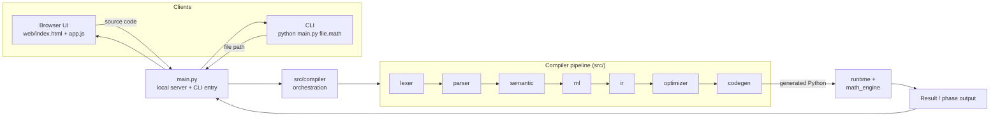

### Web request flow

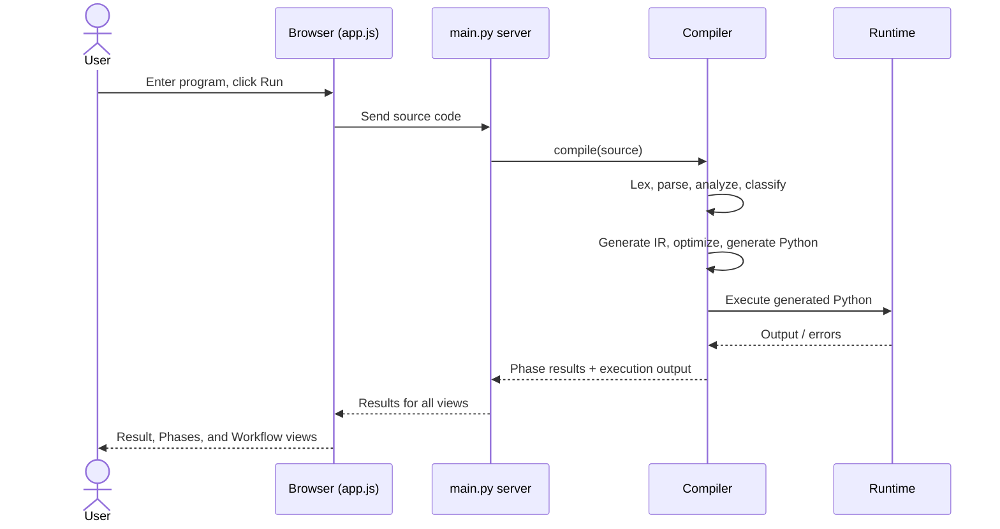

---

## Compiler pipeline

The browser's **Workflow** view presents these ten stages:

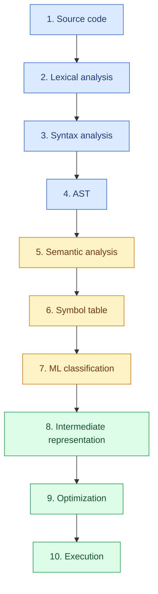

| Group | Stages | Purpose |
|-------|--------|---------|
| Front end | 1–4 | Turn text into a structured tree |
| Analysis | 5–7 | Validate meaning and classify the program |
| Back end | 8–10 | Generate, optimize, and run code |

Internally, the compiler generates Python from the optimized IR before execution. The web interface also provides phase tabs for tokens, AST, semantic analysis, symbols, ML classification, IR, optimized IR, and execution.

### Error handling

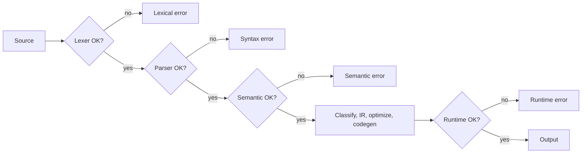

---

## Phase-by-phase walkthrough

All phases below follow this example program. The intermediate formats shown are **illustrative** of what each phase produces; exact token names, node names, and IR shapes depend on the implementation (see [docs/](docs/)).

```text
x = 10
y = 20
z = x + y
show z
```

### Phase 1 · Source code

Plain text from the browser editor, a preset, or a `.math` file.

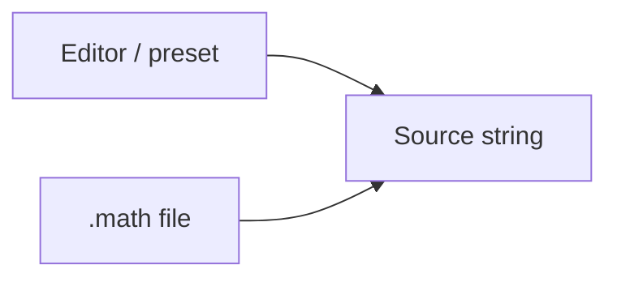

### Phase 2 · Lexical analysis (`src/lexer/`)

Characters become tokens.

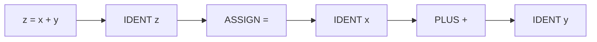

### Phase 3 and 4 · Syntax analysis and AST (`src/parser/`)

The parser applies grammar and operator precedence and builds the AST.

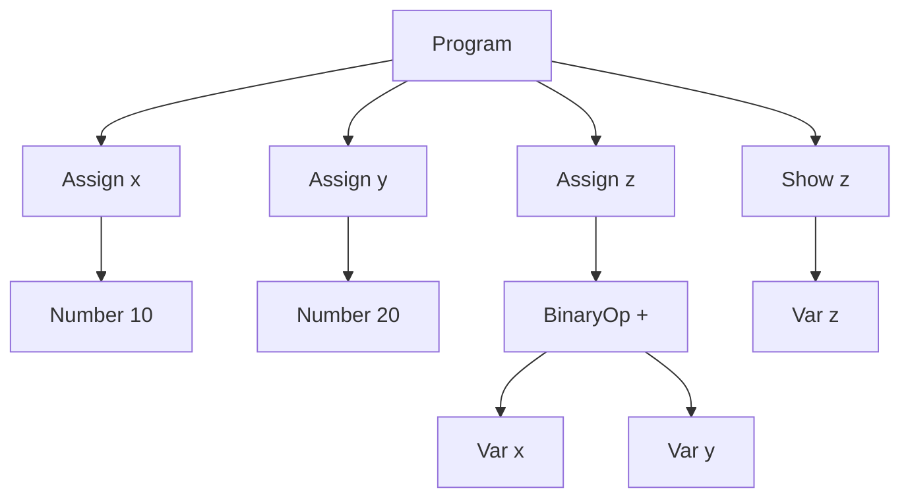

### Phase 5 and 6 · Semantic analysis and symbol table (`src/semantic/`)

Checks that names are defined before use and that operations are valid. Declared names go into the symbol table.

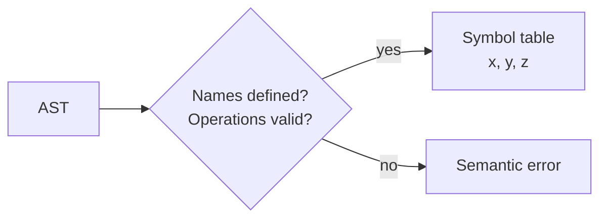

| Symbol | Kind (illustrative) |
|--------|---------------------|
| `x` | number |
| `y` | number |
| `z` | number |

### Phase 7 · ML classification (`src/ml/`)

A local classifier assigns the program a category and a confidence score.

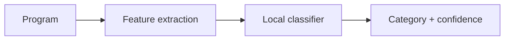

### Phase 8 · Intermediate representation (`src/ir/`)

The AST is lowered to a simple, linear form.

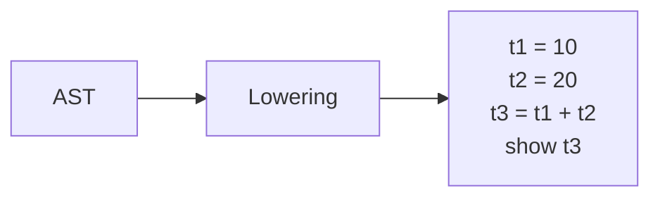

### Phase 9 · Optimization (`src/optimizer/`)

The optimizer rewrites the IR into a cheaper equivalent. For example, constant folding (illustrative):

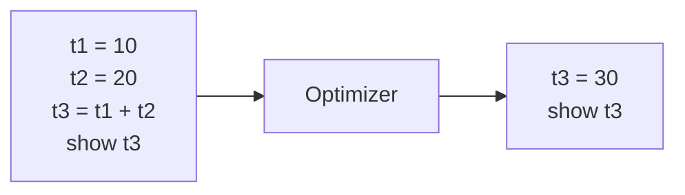

### Phase 10 · Code generation and execution (`src/codegen/`, `src/runtime/`, `src/math_engine/`)

Python is generated from the optimized IR and executed. Runtime helpers and the math engine handle vectors, matrices, `solve`, and regression metrics.

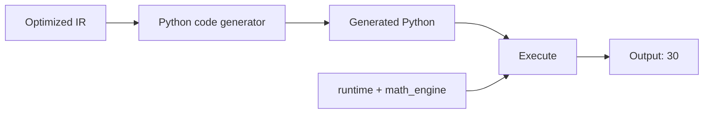

### All phases at a glance

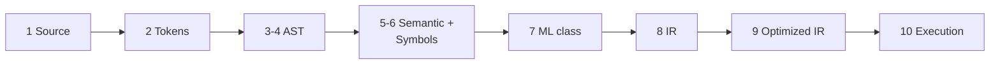

---

## Project structure

```text
.
├── main.py                 # Local web server and file-based CLI entry point
├── requirements.txt        # Python dependencies
├── SETUP.md                # Installation and run instructions
├── docs/                   # Language and compiler phase documentation
├── examples/               # Sample .math programs
├── src/
│   ├── lexer/              # Tokenizer and token definitions
│   ├── parser/             # Parser and AST node definitions
│   ├── semantic/           # Semantic checks and symbol table
│   ├── ml/                 # Local program classifier
│   ├── ir/                 # Intermediate representation
│   ├── optimizer/          # IR optimization
│   ├── codegen/            # Python code generation
│   ├── runtime/            # Math runtime helpers
│   ├── math_engine/        # Equation, matrix, and metric operations
│   └── compiler/           # Compiler orchestration
└── web/
    ├── index.html          # Browser interface structure
    ├── style.css           # Interface styling
    └── app.js              # Browser interaction and rendering
```

---

## Setup

Requirements: Python 3.11 or newer and pip. From the project root:

```bash
python -m pip install -r requirements.txt
```

A virtual environment is recommended. Platform-specific steps are in [SETUP.md](SETUP.md).

---

## Run the web interface

```bash
python main.py
```

Open [http://localhost:5000](http://localhost:5000). Enter a program or pick a preset, then choose **Run**.

- **Workflow** shows the compiler stages.
- The output tabs let you inspect individual phase results.
- The terminal also logs the pipeline.

Stop the server with `Ctrl+C`. Port 5000 must be available.

---

## Run a `.math` file

```bash
python main.py examples/01_basic.math
python main.py examples/05_vectors.math
python main.py examples/06_matrices.math
```

File mode prints the compiler pipeline and final execution output. CLI phase flags are not implemented; use the browser interface to inspect individual phase outputs.

---

## Examples

The `examples/` directory includes programs for basic expressions, functions, precedence, errors, vectors, matrices, linear equations, and regression metrics.

```text
x = 10
y = 20
z = x + y
show z
```

```bash
python main.py examples/01_basic.math
```

---

## Tests

If a test suite is included in your checkout, run it from the project root:

```bash
python -m pytest
```